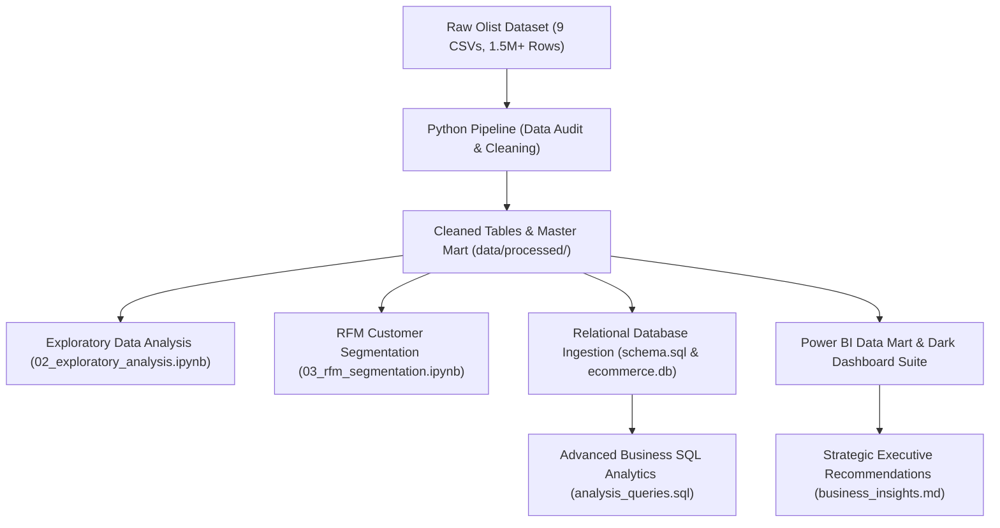

# 📊 Brazilian E-Commerce Customer & Sales Analytics (Olist)
### *End-to-End Advanced Data Analytics, SQL Database, RFM Segmentation & Power BI Suite*

[](https://python.org)
[](https://pandas.pydata.org)
[](https://www.postgresql.org)
[](https://powerbi.microsoft.com)
[](LICENSE)

---

## 📌 Project Overview & Business Problem

In fast-growing e-commerce marketplaces, businesses frequently face critical operational challenges:
1. **The Single-Purchase Dilemma:** Spending significant capital acquiring users who never make a second order.
2. **Logistics Bottlenecks:** Balancing customer delivery promises against freight costs and shipping delays across wide geographies.
3. **Customer Segmentation Deficits:** Treating all customers uniformly rather than tailoring retention campaigns based on historical value and behavior.

This project delivers an enterprise-grade, end-to-end data analysis of the **Brazilian E-Commerce Public Dataset by Olist** (comprising **99,441 orders**, **96,096 customers**, and **1.5M+ records**). It uncovers purchasing patterns, evaluates sales dynamics, executes RFM customer segmentation, architects a relational SQL schema, and provides an executive Power BI dashboard suite.

---

## 🏗️ Project Architecture & Workflow



---

## 💻 Tech Stack & Tools

- **Programming & Analysis:** Python 3.11, Pandas, NumPy
- **Data Visualization:** Matplotlib, Seaborn, Chart.js
- **Database & Querying:** ANSI SQL, SQLite3, PostgreSQL / MySQL compatible
- **Business Intelligence:** Microsoft Power BI, DAX Measure Architecture, Custom Obsidian Dark Theme
- **Development & Version Control:** Jupyter Notebooks, Git, GitHub

---

## 📂 Project Repository Structure

```
E-commerce Customer Analysis/
│
├── data/
│   ├── raw/                           # Original Olist Kaggle CSV tables (9 files)
│   ├── processed/                     # Cleaned, translated, and engineered datasets
│   │   ├── master_ecommerce_cleaned.csv
│   │   ├── rfm_customer_segments.csv
│   │   ├── powerbi_reporting_mart.csv
│   │   └── [normalized cleaned tables]
│   └── ecommerce.db                   # Populated relational SQLite database
│
├── notebooks/
│   ├── 01_data_cleaning.ipynb         # Raw data audit, transformation & feature pipeline
│   ├── 02_exploratory_analysis.ipynb  # Comprehensive EDA, sales trends & logistics metrics
│   └── 03_rfm_segmentation.ipynb      # RFM mathematical modeling & customer tiering
│
├── sql/
│   ├── schema.sql                     # Production DDL schema with PK/FK constraints & indexes
│   └── analysis_queries.sql           # 10 advanced business SQL queries (CTEs, Window Functions)
│
├── dashboards/
│   ├── interactive_powerbi_dashboard.html # Standalone 5-page interactive Power BI simulator
│   ├── DAX_Measures_Library.dax       # Enterprise DAX calculation formulas
│   ├── PowerBI_Data_Model_Architecture.md # Kimball star schema ERD & visual specs
│   ├── dark_theme.json                # Custom Obsidian Dark Power BI theme palette
│   └── README.md                      # Power BI import & setup instructions
│
├── reports/
│   ├── business_insights.md           # 11 actionable, data-backed strategic business insights
│   └── data_quality_report.md         # Schema audit, anomaly detection & cleaning report
│
├── visualizations/                    # Publication-grade charts (300 DPI)
│   ├── fig01_monthly_revenue_trend.png
│   ├── fig02_revenue_by_top_categories.png
│   ├── fig03_geographic_distribution_states.png
│   ├── fig05_payment_method_breakdown.png
│   ├── fig06_purchase_timing_heatmap.png
│   ├── fig07_delivery_performance_vs_reviews.png
│   ├── fig09_rfm_customer_segments_distribution.png
│   └── fig10_rfm_recency_monetary_scatter.png
│
├── src/                               # Reusable Python scripts
│   ├── clean_data.py
│   ├── eda_analysis.py
│   ├── rfm_analysis.py
│   ├── run_sql_analysis.py
│   └── export_powerbi_mart.py
│
├── requirements.txt                   # Environment package dependencies
├── .gitignore                         # Version control ignore rules
└── README.md                          # Master documentation
```

---

## 📈 Key Performance Indicators (KPIs) Summary

| Category | Metric | Exact Calculated Value | Business Interpretation |
| :--- | :--- | :---: | :--- |
| **Financials** | **Total Gross Merchandise Value (GMV)** | **R$ 15,419,773.75** | Combined sales across all delivered orders |
| **Financials** | **Total Product Revenue** | **R$ 13,221,498.11** | Pure item sales excluding logistics fees |
| **Financials** | **Total Freight Fees** | **R$ 2,198,275.64** | Freight represents 14.26% of gross marketplace revenue |
| **Financials** | **Average Order Value (AOV - Total)** | **R$ 159.83** | Average order basket including shipping |
| **Financials** | **Average Order Value (Item Price Only)**| **R$ 137.04** | Average product price per basket |
| **Customers** | **Total Unique Individual Customers** | **96,096** | True human entities (`customer_unique_id`) |
| **Customers** | **Delivered Unique Customers** | **93,358** | Customers with at least 1 completed order |
| **Customers** | **One-Time Buyers** | **90,557 (97.00%)** | Severe single-purchase bottleneck |
| **Customers** | **Repeat Customers** | **2,801 (3.00%)** | Customers purchasing 2 or more times |
| **Customers** | **Average Customer Lifetime Value (CLV)** | **R$ 165.17** | Cumulative revenue generated per customer |
| **Logistics** | **Total Completed / Delivered Orders** | **96,478 (97.02%)** | 97.02% fulfillment completion rate |
| **Logistics** | **Median Actual Delivery Lead Time** | **10.2 Days** | Time from order placement to doorstep arrival |
| **Logistics** | **Median Estimated Delivery Window** | **23.2 Days** | Promised delivery date (13-day conservative buffer) |
| **Logistics** | **Delayed Deliveries Rate** | **8.11%** | Orders arriving after the promised date |
| **Customer Sat**| **On-Time Delivery Review Score** | **4.29 / 5.0 ★** | 78.2% 5-star ratings for punctual deliveries |
| **Customer Sat**| **Delayed Delivery Review Score** | **2.57 / 5.0 ★** | -1.72 ★ rating penalty caused by delays |

---

## 🎯 Customer Segmentation (RFM Analysis)

Customers were scored across **Recency ($R$)**, **Frequency ($F$)**, and **Monetary ($M$)** dimensions. Given that 97% of customers are single-time buyers, we implemented custom discrete scoring for Frequency alongside empirical quintiles for Recency and Monetary values.

```
       5 |     Champions (1.1%)       Potential Loyalists (23.5%)
         |       R: 4-5, F: 3+, M: 4-5          R: 4-5, F: 1-2, M: 3-5
         |     ----------------------------------------------------------
F / M    |     Loyal Customers (0.9%) New Customers (15.3%)
         |       R: 3-5, F: 3+, M: 3-4          R: 4-5, F: 1, M: 1-2
         |     ----------------------------------------------------------
       1 |     At Risk / Lost (1.1%)  Hibernating (58.2%)
         |       R: 1-2, F: 3+, M: 1-5          R: 1-2, F: 1, M: 1-3
         +--------------------------------------------------------------
                          Low <---------------------> High (Recency)
```

### Segment Breakdown & Operational Matrix

| Segment | Customer Count | % of Customers | Total Revenue (BRL) | % of Revenue | Avg Customer Spend | Avg Recency | Actionable Marketing Strategy |
| :--- | :---: | :---: | :---: | :---: | :---: | :---: | :--- |
| **Hibernating** | 54,333 | 58.20% | R$ 8,602,907.14 | 55.79% | R$ 158.34 | 337.1 days | Low-cost clearance email drip; purge invalid contacts to preserve sender reputation |
| **Potential Loyalists** | 21,889 | 23.45% | R$ 5,169,680.16 | 33.53% | R$ 236.18 | 91.2 days | **#1 Growth Lever:** 14-day post-delivery nurture series, category cross-sell, 2nd order discount |
| **New Customers** | 14,335 | 15.35% | R$ 782,998.99 | 5.08% | R$ 54.62 | 89.8 days | Welcome onboarding sequence, mobile app download incentive, product discovery guides |
| **Champions** | 990 | 1.06% | R$ 368,322.77 | 2.39% | R$ 372.04 | 88.8 days | VIP concierge tier, early access to flagship sales, brand advocacy & referral perks |
| **Cannot Lose Them** | 750 | 0.80% | R$ 265,495.73 | 1.72% | R$ 353.99 | 380.5 days | High-touch executive win-back campaigns, substantial reactivation credits, satisfaction survey |
| **Loyal Customers** | 823 | 0.88% | R$ 207,127.63 | 1.34% | R$ 251.67 | 183.9 days | Multi-item basket discounts, free shipping thresholds, complementary category promotions |
| **At Risk** | 238 | 0.25% | R$ 23,241.33 | 0.15% | R$ 97.65 | 388.1 days | Automated dynamic retargeting ads and time-sensitive re-engagement discounts |

---

## 🗄️ Relational Database & SQL Business Analysis

All cleaned data is ingested into a relational schema with enforced primary keys, foreign keys, and indexes. Production SQL queries utilizing **Common Table Expressions (CTEs)**, **Window Functions** (`LAG`, `NTILE`, `SUM() OVER()`), and multi-table joins are located in `sql/analysis_queries.sql`.

### Highlighted Query: Monthly Revenue Trends & MoM Growth (Window Function)
```sql
WITH monthly_metrics AS (
    SELECT 
        o.order_purchase_year_month AS year_month,
        COUNT(DISTINCT o.order_id) AS total_orders,
        ROUND(SUM(oi.price), 2) AS monthly_revenue,
        ROUND(SUM(oi.total_value), 2) AS monthly_gross_sales
    FROM orders o
    JOIN order_items oi ON o.order_id = oi.order_id
    WHERE o.order_status = 'delivered'
      AND o.order_purchase_year_month BETWEEN '2017-01' AND '2018-08'
    GROUP BY o.order_purchase_year_month
)
SELECT 
    year_month,
    total_orders,
    monthly_revenue,
    LAG(monthly_revenue, 1) OVER (ORDER BY year_month) AS prev_month_revenue,
    ROUND(
        (monthly_revenue - LAG(monthly_revenue, 1) OVER (ORDER BY year_month)) / 
        LAG(monthly_revenue, 1) OVER (ORDER BY year_month) * 100.0, 
        2
    ) AS mom_revenue_growth_pct,
    ROUND(SUM(monthly_revenue) OVER (ORDER BY year_month), 2) AS cumulative_revenue
FROM monthly_metrics
ORDER BY year_month;
```

---

## 🖥️ Power BI Executive Dashboard Suite

The Power BI solution is delivered as an **Obsidian Dark-Themed** analytical cockpit comprising 5 comprehensive pages:

- **PAGE 1: Executive Overview:** High-level GMV cards, monthly trajectory, category Pareto bar chart, and state-level market share.
- **PAGE 2: Customer Insights:** New vs returning customer share, customer concentration treemap, frequency distribution, and spending deciles.
- **PAGE 3: Customer Segmentation (RFM):** Customer share vs revenue share comparative bars, log-scale recency-monetary scatter, and segment action matrix.
- **PAGE 4: Product & Sales Analysis:** Category GMV vs volume quadrant, payment rail share (Credit Card, Boleto, Voucher, Debit), and installment financing histogram.
- **PAGE 5: Customer Retention & Logistics SLA:** Monthly cohort survival heatmap matrix, delivery lead time vs estimated promise buffer, and review rating collapse on delayed shipments.

> 💡 **Interactive Preview:** Open `dashboards/interactive_powerbi_dashboard.html` in any modern web browser to interact with the live 5-page dashboard.

---

## 🚀 Installation & Execution Guide

### 1. Clone Repository & Setup Environment
```bash
git clone https://github.com/your-username/ecommerce-customer-analysis.git
cd ecommerce-customer-analysis
python -m venv venv
# Windows:
venv\Scripts\activate
# Linux/macOS:
source venv/bin/activate
pip install -r requirements.txt
```

### 2. Execute Data Pipeline
Run the modular Python pipeline sequentially:
```bash
# Clean raw tables and generate master dataset
python src/clean_data.py

# Run Exploratory Data Analysis & generate high-res visual charts
python src/eda_analysis.py

# Perform RFM customer segmentation
python src/rfm_analysis.py

# Build SQLite database and execute all 10 SQL business queries
python src/run_sql_analysis.py

# Export Power BI reporting mart
python src/export_powerbi_mart.py
```

### 3. Run Jupyter Notebooks
```bash
jupyter notebook notebooks/
```
Explore the guided notebooks:
- `01_data_cleaning.ipynb`
- `02_exploratory_analysis.ipynb`
- `03_rfm_segmentation.ipynb`

---

## 📄 Key Business Insights Summary

1. **Repurchase Deficit:** 97% of customers buy once. Increasing repeat purchase rate by 3% unlocks R$ 460k+ in high-margin revenue.
2. **Logistics Satisfaction Penalty:** Deliveries delayed past promise drop from 4.29 ★ to 2.57 ★ (-1.72 ★ penalty).
3. **Overestimated Delivery Promise:** Orders arrive 13 days earlier than the 23-day estimate, causing checkout cart abandonment.
4. **Geographic Concentration:** SP, RJ, and MG represent 66.6% of the customer base and 63.4% of total GMV.
5. **Credit Card Installments:** 78.5% of GMV flows through credit cards with an average of 3.5 installments.
6. **Growth Opportunity:** Potential Loyalists (21,889 users) contribute 33.5% of GMV (R$ 5.17M) and are primed for 2nd order conversion.

*For full deep-dive analyses and strategic implementation roadmaps, read [reports/business_insights.md](reports/business_insights.md).*

---

## 📜 License
This project is open-source under the [MIT License](LICENSE).
Dataset source: [Brazilian E-Commerce Public Dataset by Olist (Kaggle)](https://www.kaggle.com/datasets/olistbr/brazilian-ecommerce).
